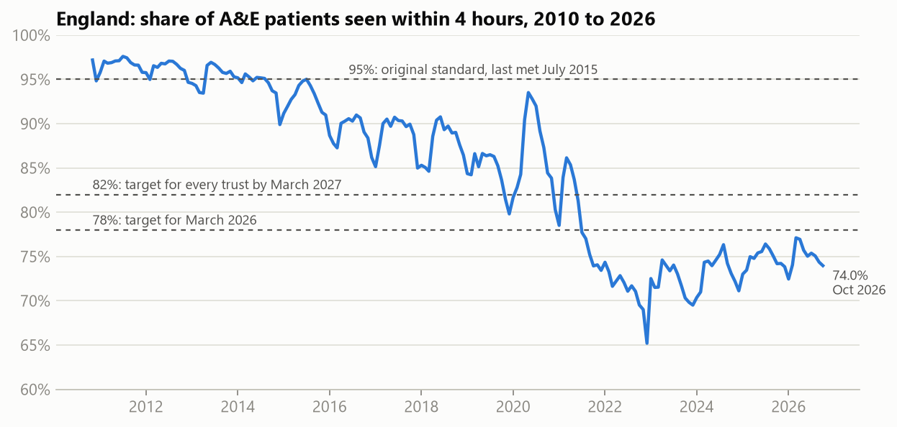
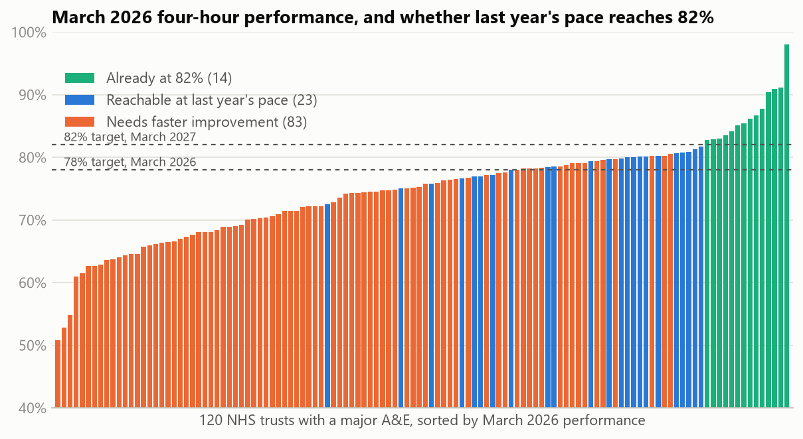
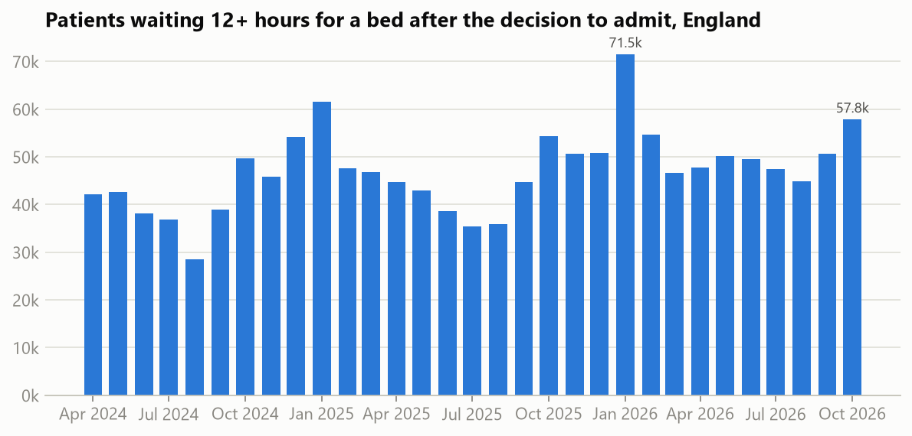
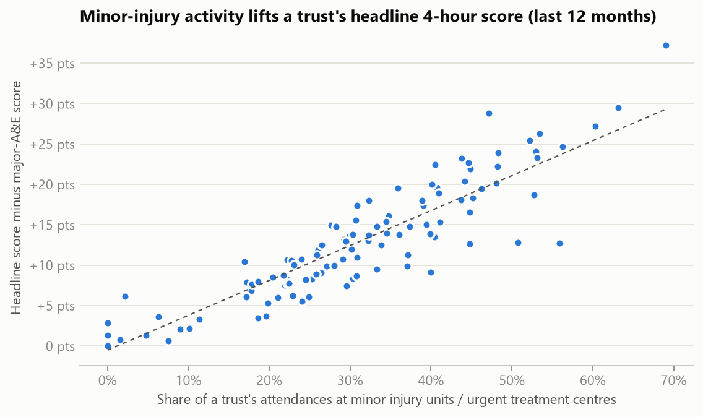

# NHS A&E Four-Hour Target Tracker

**NHS England has told every hospital trust to see at least 82% of A&E patients within four hours by March 2027. Which trusts can realistically get there, and what is holding the others back?**

This project uses NHS England's official monthly A&E statistics for every provider, **April 2024 to October 2026** (latest release), plus the national series back to 2010. It checks each of the 120 trusts with a major A&E against the 2026 and 2027 targets, tests whether a simple forecast can be trusted, and examines what separates the best performers from the rest. An interactive app lets you look up any trust.

**▶ Interactive app: [nhs-ae-performance.streamlit.app](https://nhs-ae-performance.streamlit.app/)**

## Results

- **England missed the March 2026 target and has since slipped back.** 77.1% of patients were seen within four hours in March 2026, against a target of 78%. In October 2026 the figure was **74.0%, slightly below October 2025 (74.2%)**, while attendances rose 4.2%. England last met the original 95% standard in **July 2015**.
- **82% by March 2027 is out of reach for most trusts at their current pace.**
  - Only **14 of 120** trusts were already at 82% in March 2026.
  - Another **23** would reach it by repeating the improvement they made over the past year.
  - **83 trusts (69%) need to improve faster than last year.** The typical trust in this group needs **+9.8 points in a year; last year it managed +0.4.** 37 trusts got worse between March 2025 and March 2026.
- **Long waits for a bed are rising.** 57,840 admitted patients waited 12+ hours from the decision to admit in October 2026, **up 6.5% on a year earlier**. The winter peak was 71,517 in January 2026. In the quarter of trusts with the most of these "trolley waits", the median major-A&E score was 58.4%, against 64.3% in the quarter with the fewest.
- **Headline league tables partly measure case mix, not performance.** The headline figure counts minor injury units and urgent treatment centres, where almost everyone is seen within four hours. The more of a trust's activity happens there, the higher its headline score: each 10 percentage points of minor-unit share adds about **4.3 points** (correlation 0.92). Ranking trusts on major A&E only moves them a **median of 20 places**, and 43 trusts move 30 or more.









## Why this doesn't forecast March 2027

My first approach projected each trust's March 2027 result from its trend: March 2026, adjusted by how its last three months compared with the same months a year earlier. Before using it, I **backtested** the method: standing in October 2025, how well would it have predicted March 2026?

| Method (predicting March 2026 from data to October 2025) | Mean error |
|---|---:|
| Trend projection | 4.4 points |
| Naive: "same as last March" | 4.0 points |

The trend method did worse than the naive guess, and was too pessimistic by 1.8 points on average. Autumn trends barely predicted the March result (correlation 0.24), because trusts make a big push in the final months before a March target. So instead of a forecast I can't defend, each trust's **status compares the improvement it still needs with the improvement it actually achieved last year**, which needs no forecast at all.

## What this means

1. **Trusts and regulators should judge major-A&E performance separately** from the headline figure. Otherwise trusts with large urgent treatment centres look better than their emergency departments are.
2. **The four-hour problem is partly a bed problem.** Trusts with more 12-hour waits for a bed perform worse even in their major A&E. Faster discharge and more available beds matter as much as what happens inside A&E.
3. **For most trusts, 82% needs a step change, not more of the same.** At last year's pace, 83 of 120 trusts will miss it.

## How it works

1. **Data** ([`nhs/data.py`](nhs/data.py)). Downloads every monthly provider CSV listed on NHS England's A&E statistics pages for 2024-25 to 2026-27, keeps the revised version of each month, drops blank and footer rows, and standardises trust names and regions. The England "TOTAL" row appears in some months but not others, so it is dropped and England is rebuilt by adding up the providers.
2. **Validation.** My England totals are checked against NHS England's own published national time series **for all 31 months: the maximum difference is 0.000 points.** `run_analysis.py` stops with an error if this ever fails.
3. **Measures.** Rates are always recomputed from pooled counts, never averaged as percentages. The measures are four-hour performance (all types, the target measure), major A&E (type 1) performance, 12-hour waits from decision to admit per 100 emergency admissions, the minor-unit share of attendances, and the admission rate.
4. **Trusts.** The 120 NHS trusts with more than 1,000 major A&E attendances in October 2026.
5. **Status** ([`nhs/analysis.py`](nhs/analysis.py)). *Already at 82%*; *Reachable at last year's pace* (March 2026 plus its March 2025 to March 2026 improvement reaches 82%); otherwise *Needs faster improvement*.

## Assumptions and limitations

- The headline measure is the one used for the targets. Major-A&E figures are shown alongside it, not instead of it.
- 12-hour waits are measured from the decision to admit, which trusts can record differently. NHS England's separate ECDS data measures 12 hours from arrival and gives higher numbers.
- Correlations across trusts describe patterns, not causes. Bed shortages, staffing and local population all overlap.
- Trusts that merged or changed codes during the period are tracked by their current code; months before a merger may be missing.

## Run it yourself

```bash
python -m venv .venv
.venv\Scripts\activate            # Windows  (macOS/Linux: source .venv/bin/activate)
pip install -r requirements.txt
streamlit run app.py              # the app, from the processed data in data/processed/
python run_analysis.py --download # fetch the latest months from NHS England and rebuild everything
pip install pytest && pytest      # 6 tests, including the check against the published England figures
```

The pipeline is built to be re-run each month when NHS England publishes new figures (usually the second Thursday).

```
nhs/          data.py (download, tidy, validate) · analysis.py (targets, backtest, drivers) · figures.py
app.py        Streamlit app
run_analysis.py
data/processed/   provider_months.csv · england_months.csv · england_since_2010.csv
outputs/      figures/ and tables/ (trust status, regions, drivers, headline numbers)
tests/
```

## Why I built this

The NHS is one of the UK's biggest employers of analysts, and performance against targets is the question they answer every month. I wanted to work the way an NHS performance analyst would: start from the official target, reconcile my numbers to the published figures, test a method before trusting it, and point out where the headline measure can mislead.

---
Data: NHS England, [A&E Attendances and Emergency Admissions](https://www.england.nhs.uk/statistics/statistical-work-areas/ae-waiting-times-and-activity/), Open Government Licence v3.0. Targets: NHS England [2025/26 operating plan position](https://www.england.nhs.uk/long-read/2025-26-operating-plan-position/) and Medium term planning framework (October 2025). Built by [Obaid Ullah Masood Raja](https://www.linkedin.com/in/raja-obaid).
